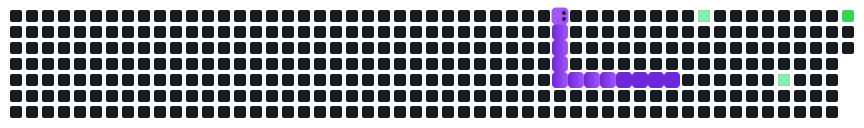

  

  

写代码一半自己敲一半跟 AI 一起敲。最近在把 Agent 往日常工作流里塞，大部分时间花在盯它出错上。

  

  <picture>
    <source media="(prefers-color-scheme: dark)" srcset="https://streak-stats.demolab.com?user=casour&theme=github-dark&background=00000000&hide_border=true&locale=zh_Hans&card_width=495&sideLabels=c9d1d9&sideNums=e6edf3&currStreakNum=e6edf3&currStreakLabel=58a6ff&dates=8b949e&ring=1f6feb&fire=8b5cf6" />
    <source media="(prefers-color-scheme: light)" srcset="https://streak-stats.demolab.com?user=casour&theme=default&hide_border=true&locale=zh_Hans&card_width=495" />
    
  </picture>

  <picture>
    <source media="(prefers-color-scheme: dark)" srcset="snake-dark.svg" />
    <source media="(prefers-color-scheme: light)" srcset="snake-light.svg" />
    
  </picture>

  
  

  

